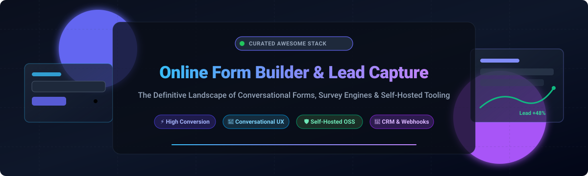
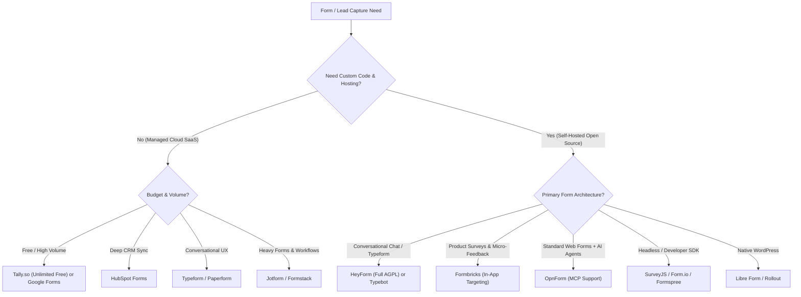

# Awesome Online Form Builder & Lead Capture Tools 📝🚀

<p align="center">
  
</p>

<p align="center">
  <a href="https://github.com/ishandutta2007/Awesome-Awesome-Awesome"></a>
  <a href="https://discord.gg/jc4xtF58Ve"></a>
  <a href="https://github.com/ishandutta2007/Awesome-Online-Form-Builder-Lead-Capture/stargazers"></a>
  <a href="https://github.com/ishandutta2007/Awesome-Online-Form-Builder-Lead-Capture/network/members"></a>
  <a href="https://github.com/ishandutta2007/Awesome-Online-Form-Builder-Lead-Capture/blob/main/LICENSE"></a>
  <a href="https://github.com/ishandutta2007"></a>
</p>

---

## 🌟 Executive Summary & Overview

Welcome to the definitive curated directory of **Online Form Builders**, **Lead Capture Engines**, **Survey Frameworks**, and **Self-Hosted Form Infrastructure**. Whether you are building high-converting landing page lead funnels, conversational multi-step onboarding flows, HIPAA/GDPR-compliant data collection pipelines, or embedding headless submission APIs directly into custom applications, this guide compares both industry-leading SaaS platforms and open-source alternatives.

---

## 📈 Sector Overview & Market Dynamics

The global online form builder and lead capture software market is estimated at **$2.5B to $3.2B in 2026**, growing at a CAGR of ~14.8% propelled by digital-first customer onboarding, inbound marketing automation, and product-led growth (PLG) micro-surveys. The sector exhibits **moderate fragmentation with bifurcated concentration**: high-volume transactional forms and CRM-linked capture are concentrated around behemoths like Alphabet (Google Forms) and HubSpot, while mid-market and boutique conversational engagement forms remain highly fragmented across specialized SaaS and emerging self-hosted open-source challengers.

---

## 📑 Table of Contents
- [📊 Sector Overview & Market Dynamics](#-sector-overview--market-dynamics)
- [🏢 SaaS & Hosted Platforms](#-saas--hosted-platforms)
- [💻 Open-Source GitHub Projects](#-open-source-github-projects)
- [⚖️ Architecture & Comparison Matrix](#️-architecture--comparison-matrix)
- [🤝 How to Contribute](#-how-to-contribute)
- [🛡️ Disclaimer & Privacy Compliance](#️-disclaimer--privacy-compliance)

---

## 🏢 SaaS & Hosted Platforms

Below is an analytical overview of the top commercial online form builder and lead capture solutions, sorted descending by company scale (valuation / annual revenue run-rate):

| Product / Platform | Company Scale (Valuation / Revenue) 🏢 | Starting Tier Pricing 💳 | Free Tier & Trial Limits 🎁 | Key Strengths & Core Differentiators 🎯 |
| :--- | :--- | :--- | :--- | :--- |
| **[Google Forms](https://forms.google.com/)** | **~$2.2 Trillion** market cap (Alphabet Inc.) | **$0** (Standalone) / Workspace starts at **$6/user/month** | **100% Free Forever** (Unlimited forms & responses; capped only by 15 GB shared Google Drive storage) | Native Google Workspace & Sheets integration, effortless collaboration, zero cost barrier. |
| **[HubSpot Forms Builder](https://www.hubspot.com/)** | **~$28.5 Billion** market cap (NYSE: HUBS) | **$15/seat/month** (Starter Customer Platform) | **Free Forever Plan** (Unlimited forms, up to 1,000 marketing contacts, includes HubSpot branding & basic email automation) | Automatic two-way CRM sync, progressive field profiling, and marketing workflow triggers. |
| **[Formstack](https://www.formstack.com/)** | **~$1.2 Billion+** valuation / **~$150M+ ARR** | **$50/month** (Forms Plan, billed annually) | **14-Day Free Trial** (Full access, limited to 5 test forms and 20 submissions during trial; no free forever tier) | Enterprise compliance (HIPAA, FERPA, SOC 2), integrated digital signatures, and PDF document generation. |
| **[Typeform](https://www.typeform.com/)** | **~$935 Million** valuation / **~$100M+ ARR** | **$25/month** (Basic Plan, billed annually) | **Free Forever Plan** (Unlimited forms, strictly capped at **10 responses/month** and 10 questions/form) | Pioneer of conversational, one-question-at-a-time interactive forms with premium UX design. |
| **[Jotform](https://www.jotform.com/)** | **~$500 Million+** valuation / **~$60M+ ARR** | **$34/month** (Bronze Plan, billed annually) | **Free Forever Plan** (5 active forms, **100 monthly submissions**, 100 MB upload storage, 1,000 form views) | 10,000+ ready-to-use form templates, integrated payment gateways, approval flows, and e-signatures. |
| **[SurveySparrow](https://surveysparrow.com/)** | **~$120 Million** valuation / **~$15M+ ARR** | **$19/month** (Starter Plan, billed annually) | **14-Day Free Trial** (Full features unlocked; free forever tier limited to **3 active forms and 50 responses/month**) | Conversational omni-channel surveys, NPS tracking, executive dashboards, and offline survey apps. |
| **[Wufoo](https://www.wufoo.com/)** | **Part of Momentive/Symphony Technology** (~$50M valuation) | **$14.08/month** (Starter Plan, billed annually) | **Free Forever Plan** (5 active forms, **100 entries/month**, 1 user, 10 fields per form) | Veteran form builder featuring legacy reliability, automated payment processing, and quick report building. |
| **[123FormBuilder](https://www.123formbuilder.com/)** | **~$35 Million** valuation / **~$8M ARR** | **$32/month** (Standard Plan, billed annually) | **Free Forever Plan** (Up to 5 forms, **100 submissions/month**, 10 fields per form, 1 user limit) | Drag-and-drop form creation with robust third-party integrations (Salesforce, Wix, Shopify) and multi-page flows. |
| **[Paperform](https://paperform.co/)** | **~$25 Million** valuation / **~$6M ARR** | **$24/month** (Essentials Plan, billed annually) | **7-Day Free Trial** (Unlimited creation features during trial; no permanent free plan) | Document-style free-form editor, AI form generation, integrated appointment scheduling, and checkout capabilities. |
| **[Tally](https://tally.so/)** | **~$15 Million** valuation / **~$3.5M ARR** | **$29/month** (Tally Pro, billed annually) | **Free Forever Plan** (**Unlimited forms & unlimited responses** with 99% of features free; 10 MB/file upload limit) | Notion-like text-command editor, free unlimited submissions, custom domains, and native webhook flexibility. |

---

## 💻 Open-Source GitHub Projects

Explore the most active and capable open-source form builders, survey engines, and backend capture APIs. Sorted in descending order by GitHub community stars ⭐:

| Project & Repository Link | Stars Badge | License 📜 | Tech Stack 🛠️ | Architectural Highlights & Capabilities 💡 |
| :--- | :---: | :--- | :--- | :--- |
| **[Formbricks](https://github.com/formbricks/formbricks)** | <a href="https://github.com/formbricks/formbricks/stargazers"></a> | AGPL-3.0 (Open-Core) | Next.js, TypeScript, Tailwind, Prisma | Complete privacy-first experience management; multi-channel in-app surveys, targeted user cohort prompts, and visual no-code builder. |
| **[Typebot](https://github.com/baptisteArno/typebot.io)** | <a href="https://github.com/baptisteArno/typebot.io/stargazers"></a> | AGPL-3.0 | Next.js, React, Node.js, PostgreSQL | Visual drag-and-drop conversational form & chatbot builder; dynamic conditionals, webhook branching, and multi-channel embed support. |
| **[HeyForm](https://github.com/heyform/heyform)** | <a href="https://github.com/heyform/heyform/stargazers"></a> | AGPL-3.0 | Node.js, React, MongoDB, Redis | Pure 100% open-source Typeform alternative; conversational one-question-at-a-time flow, rich logic branching, drop-off analytics, and zero feature gating. |
| **[SurveyJS](https://github.com/surveyjs/survey-library)** | <a href="https://github.com/surveyjs/survey-library/stargazers"></a> | MIT (Core Library) | TypeScript, React, Angular, Vue | Headless, highly extensible JavaScript survey & form UI library; custom JSON schemas, complex validations, and framework-agnostic embedding. |
| **[OpnForm](https://github.com/opnform/opnform)** | <a href="https://github.com/opnform/opnform/stargazers"></a> | AGPL-3.0 | Laravel (PHP), Vue.js, MySQL | Full-featured Typeform alternative; unlimited submissions, logic jumps, AI form generation, MCP server for AI agent integrations, and webhook triggers. |
| **[TellForm](https://github.com/tellform/tellform)** | <a href="https://github.com/tellform/tellform/stargazers"></a> | MIT | Node.js, AngularJS, MongoDB | Classic open-source alternative to Typeform; clean UX for polls, quizzes, and forms with data export and custom webhooks. |
| **[OhMyForm](https://github.com/ohmyform/ohmyform)** | <a href="https://github.com/ohmyform/ohmyform/stargazers"></a> | AGPL-3.0 | Node.js, Vue.js, MongoDB | Community-driven form builder fork with modular architecture, encryption, multi-language support, and custom themes. |
| **[Formspree CLI / Core](https://github.com/formspree/formspree)** | <a href="https://github.com/formspree/formspree/stargazers"></a> | PolyForm Shield / Open | Python, Flask, HTML5 | Developer-centric headless form endpoint; submit static HTML forms directly via HTTP POST without maintaining a backend server. |
| **[Form.io Core](https://github.com/formio/formio.js)** | <a href="https://github.com/formio/formio.js/stargazers"></a> | MIT | JavaScript, JSON Schema | Enterprise-grade nested form renderer and builder SDK; dynamic data-driven schemas, workflow orchestration, and offline caching. |
| **[Endatix](https://github.com/endatix/endatix)** | <a href="https://github.com/endatix/endatix/stargazers"></a> | MIT | .NET Core, C#, SurveyJS | Developer-first form management backend; utilizes SurveyJS JSON definitions, event pipelines, and modular storage providers. |
| **[Libre Form](https://github.com/libreform/libreform)** | <a href="https://github.com/libreform/libreform/stargazers"></a> | GPL-3.0 | PHP, WordPress, MariaDB | Native WordPress form plugin; accepts raw HTML5 form code, creates dedicated SQL storage tables per form, and includes anti-spam validation. |
| **[GopherCRM](https://github.com/florinel-chis/GopherCRM)** | <a href="https://github.com/florinel-chis/GopherCRM/stargazers"></a> | GPL-3.0 | Go (Golang), React, SQLite | Self-hosted micro-CRM with built-in public lead capture endpoints, contact management, deal stages, and automatic notification pipelines. |

---

## ⚖️ Architecture & Comparison Matrix



---

## 🔍 Search & Keyword Optimization (SEO Guide)

This curated repository is designed for developers, growth engineers, and digital marketers searching for:
- **Best Open-Source Typeform Alternatives 2026**: Self-host conversational surveys with HeyForm, OpnForm, and Typebot.
- **Top Lead Capture Engines**: Compare Jotform vs Typeform vs Tally vs HubSpot forms with exact pricing and free submission limits.
- **Self-Hosted Survey Infrastructure**: In-app feedback targeting using Formbricks, SurveyJS, and Endatix.
- **Headless Form APIs**: Eliminate custom backend endpoints for static websites using Formspree and Form.io.

---

## 🤝 How to Contribute

We welcome additions, corrections, and improvements from the open-source and marketing technology community!

1. **Fork the repository** to your personal GitHub account.
2. **Create a descriptive feature branch**:
   ```bash
   git checkout -b feat/add-new-form-tool
   ```
3. **Add or modify entries** in `README.md`:
   - Follow the established markdown table structure.
   - For SaaS: verify exact starting tier pricing, non-generic free tier limits, and valuation/scale.
   - For Open Source: include repository URL, correct star badge, open-source license, and primary language stack.
4. **Commit your updates** with a clear message:
   ```bash
   git commit -m "feat: add NewFormTool to open-source table"
   ```
5. **Push and submit a Pull Request** with verification links.

---

## 🛡️ Disclaimer & Privacy Compliance

- **Community Curated**: This repository is maintained as a free public knowledge-base and does not constitute commercial endorsement or affiliate sponsorship.
- **Data Compliance (GDPR, CCPA, HIPAA)**: Form builders and lead capture tools directly process Personally Identifiable Information (PII). When deploying self-hosted instances (e.g., OpnForm, Formbricks, HeyForm), system administrators bear sole responsibility for SSL termination, database encryption, automated backups, and user consent compliance.
- **Open-Core Licensing**: Several open-source projects enforce open-core licensing models where enterprise features (SSO/SAML, audit logs, team workspaces, multi-seat OIDC) are gated under proprietary commercial licenses. Verify organizational requirements against license terms before production rollout.

---

<p align="center">
  <sub>Maintained with ❤️ by <a href="https://github.com/ishandutta2007">Ishan Dutta</a> and the open-source community. If this curated directory assisted your tech stack selection, please consider giving it a ⭐!</sub>
</p>
